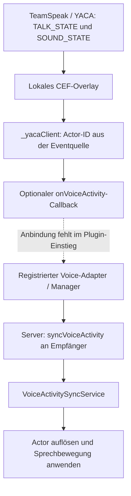

[Deutsch](docs_voice_lipsync_status.md) · [English](../../en/docs/docs_voice_lipsync_status.md) · [Русский](../../ru/docs/docs_voice_lipsync_status.md)

# Lipsync für Voice-Chat: Stand und benötigte Informationen

Stand: **27. Oktober 2026**. Geprüft wurden die aktuellen lokalen Quellen in
`D:\GitHub\skymp` (HEAD `5a70479f1944` plus lokale Änderungen) und
`D:\GitHub\SkyMP-YACA-TS` (HEAD `ab8e9bc55a45` plus lokale Änderungen).
Die Commit-IDs allein enthalten insbesondere die neue lokale YACA-Bridge nicht.
Dieser Befund beschreibt den Quellstand; er bestätigt keinen installierten
Serverbuild oder Client und keine erfolgreiche Spielsitzung.

## Ist es bereits gelöst?

**Teilweise vorbereitet, aber noch keine durchgängig fertige und im Spiel
nachgewiesene Lipsync-Lösung.** Der Fork enthält einen Voice-Activity-Vertrag,
serverseitige Verteilung und einen registrierten Client-Handler. Die neue
YACA-Bridge erkennt den Sprechstatus, verbindet ihn im ausgelieferten
Plugin-Einstieg aber nicht mit diesem Animationspfad.

Der vorhandene Ansatz überträgt nur **„spricht / spricht nicht“**. Der Client
versucht daraufhin eine Dialoganimation abzuspielen. Audiopegel, Audiodaten,
Phoneme oder Viseme werden in diesem Pfad nicht übertragen oder ausgewertet.
Audioabhängige oder lautgetreue Lippenbewegungen sind damit nicht implementiert.
Auch die Eignung der verwendeten Dialoganimation als sichtbare Mundbewegung ist
noch in Skyrim zu belegen.

## Welche Bausteine existieren?

| Baustein | Was im Quellstand vorhanden ist | Grenze |
| --- | --- | --- |
| [Voice-Activity-Vertrag](../../../../skymp5-server/ts/voiceActivityApi.ts) | `VoiceActivityState` mit Actor-ID, Sprechstatus, Reichweite in Metern, Provider und Zeitstempel; `IVoiceProviderAdapter` als Schnittstelle | Die Schnittstelle selbst stellt keinen Voice-Transport her. |
| [Voice Activity Manager](../../../../skymp5-server/ts/voiceActivityManager.ts) | Adapterregistrierung, Zustand je Actor, Inaktivitätstimer, Broadcast-Callback und Diagnose | Zustandsführung und Timeout greifen beim Eingang über registrierte Adapter. Der bestehende Custom-Packet-Eingang umgeht diese Zustandsführung. |
| [Server-Einbindung](../../../../skymp5-server/ts/index.ts) | Aktivierung durch `voiceActivity.enabled === true`, Empfängerauswahl und Versand von `syncVoiceActivity` | Entfernungsberechnung und Eingangspfad müssen korrigiert werden; Aktivieren allein verbindet die neue Bridge nicht. |
| [YACA-Adapter im Server](../../../../skymp5-server/ts/adapters/YacaTeamSpeakAdapter.ts) | `handleYacaVoiceEvent(...)` erzeugt passende Zustände und ruft die registrierten Callbacks auf | `initialize()` enthält keinen eigenen YACA-Transport. Der Adapter ist ein Gerüst. |
| Neue lokale YACA-Bridge | `SkyMP-YACA-TS/ui/protocol.js` liest `TALK_STATE` und `SOUND_STATE`; `src/clientSources.ts` meldet über `_yacaClient`; `src/yacaBridge.ts` bietet `onVoiceActivity` | Der optionale Callback ist standardmäßig leer. `tools/build-plugin.cjs` übergibt im Plugin-Einstieg keinen Callback. |
| [Client-Service](../../../../skymp5-client/src/services/services/voiceActivitySyncService.ts) | Empfängt Custom Packets über den Controller; ist in [index.ts](../../../../skymp5-client/src/index.ts) registriert | Ein registrierter Handler belegt weder den vollständigen Transport noch sichtbare Animationen. |
| [Animationshandler](../../../../skymp5-client/src/sync/voiceActivitySync.ts) | Liest `syncVoiceActivity`, sucht den Actor und ruft `playIdle` für die als `IDLE_DIALOGUE_LOCK` bezeichnete Form `0x0005B1B0` auf; Wiederholung alle 2 Sekunden | Actor-Zuordnung, Wirkung der Form und zuverlässiges Beenden sind offen. |
| [Admin-API](../../../../skymp5-server/ts/ui.ts) | `GET /api/admin/voice/status` und `GET /api/admin/voice/speakers`, jeweils mit `canViewLogs` | Keine eigene Voice-Diagnoseansicht im Frontend gefunden. Ein gesunder Adapterstatus bestätigt keine TeamSpeak-Verbindung. |

Die aktuelle Bridge benötigt für ihren Voice-/UI-Pfad keine `YacaBridgeQuest`,
ESP oder PEX. Ältere Beschreibungen eines Papyrus-Transports sind Entwürfe und
beschreiben diese neue lokale Plugin-Implementierung nicht.

## Wie würde die Verbindung aussehen?



Der Bridge-Callback liefert `{ actorId, isSpeaking, voiceRange }`. Ein Adapter
müsste den Provider und einen serverseitigen Zeitstempel ergänzen und den Zustand
über seine beim Manager registrierten Callbacks melden.

Daneben gibt es bereits einen älteren Eingang für die Custom-Packet-Typen
`voiceActivity` und `yaca:voiceActivity`. Er ruft direkt
`manager.broadcastVoiceActivity(...)` auf. Er ist deshalb kein gleichwertiger
Ersatz für die vollständige Adapter-/Manager-Zustandsführung. Die neue Bridge
nutzt ihn nicht automatisch. Paketformate und Konfiguration stehen in der
[API-Referenz](docs_voice_api.md).

## Was muss technisch noch erledigt werden?

Diese Punkte ergeben sich aus dem vorhandenen Code und benötigen zunächst
keine weiteren Angaben vom Betreiber:

| Offener Punkt | Konkreter Befund | Benötigter Abschluss |
| --- | --- | --- |
| Bridge anbinden | `onVoiceActivity` fällt ohne Übergabe auf einen leeren Callback zurück. | Einen bewusst gewählten, vollständigen Weg vom Bridge-Sprechstatus zum Animationszustand implementieren. |
| Eingang und Zustandsführung vereinheitlichen | Der Custom-Packet-Pfad sendet direkt weiter: Registry, Reichweitenprüfung des Managers und Inaktivitätstimer werden dabei umgangen. Eine Actor-ID aus dem Payload kann außerdem die Absender-ID ersetzen. | Actor serverseitig dem Absender zuordnen, Felder strikt prüfen und Zustände einschließlich Stop/Timeout durch denselben Eingang führen. |
| Einheitliche Entfernung | `getActorPos` liefert Spielkoordinaten. `index.ts` vergleicht deren Abstand unmittelbar mit als Meter definierten Werten. | Einheitliche Umrechnung und Raumtrennung verwenden. Die Bridge verwendet bereits `client.unitsPerMeter` mit Startwert 70; der Wert muss im Spiel kalibriert werden. |
| Server-ID auf Client-Actor abbilden | `voiceActivitySync.ts` gibt die Server-Actor-ID direkt an `Game.getFormEx`. Andere Clientpfade verwenden dafür [remoteIdToLocalId](../../../../skymp5-client/src/view/worldViewMisc.ts). | Dynamische Remote-Actors korrekt auflösen und fehlende/noch nicht gestreamte Actors behandeln. |
| Sichtbare Bewegung und Stop | Der Handler versucht `playIdle(0x0005B1B0)`. Bei `false` ruft er `stopTranslation()` auf; ein passender Gesichts-/Animationsreset ist dort nicht implementiert. | Geeignete Bewegung und Reset in Skyrim belegen, einschließlich Laufen, Kampf und anderer Animationen. |
| Meldetakt und Timeout | Die Bridge meldet Änderungen sofort und unveränderten Status ungefähr alle 2 Sekunden. Der im API-Vertrag definierte Timeout beträgt 1000 ms. | Heartbeat und Timeout aufeinander abstimmen; Manager-Defaults beim Serverstart zuverlässig übernehmen. Ein kürzerer Timeout allein löst die Lücke nicht. |
| Aufräumen und verlorene Stop-Meldungen | Der Client wiederholt die Animation bis zu einer Stop-Meldung oder zum Verbindungsabbau; ein eigener Ablaufzeitpunkt fehlt. `removePlayer()` entfernt nur den Serverzustand. | Stop/Failsafe bei Disconnect, Despawn, Raum-/Reichweitenwechsel und Reconnect vorsehen, auch für frühere Empfänger. |
| Diagnose korrekt zählen | `YacaTeamSpeakAdapter` erhöht bei jeder `true`-Meldung den Sprecherzähler erneut. Direkt weitergeleitete Custom Packets erscheinen nicht in der Manager-Registry. | Zustandswechsel je Actor zählen und Diagnosewerte mit dem tatsächlichen Datenweg abgleichen. |

Für die Fertigstellung sind zwei Wege denkbar: den vorhandenen Manager-/Clientpfad
korrigieren und anbinden oder die einfache Sprechbewegung vollständig im
eigenständigen YACA-Plugin umsetzen. Im zweiten Fall könnte eine Neighbor-Property
den Sprechstatus am bereits aufgelösten `ctx.refr` anwenden. **Das ist ein
Implementierungsvorschlag, noch keine vorhandene Plugin-Funktion.** Auch dort
müssen Hörbarkeit, Ablauf und Animationsreset gelöst werden.

Bei Änderungen am eingebauten Client-Handler wird ein aktualisiertes
Client-JavaScript-Paket benötigt. Ob für die gewünschte Gesichtssteuerung weitere
native Änderungen nötig sind, hängt vom gewählten Verfahren und dessen Spieltest
ab. Ein zusätzlicher nativer DLL-Build ist aus dem bisherigen Befund nicht belegt.

## Welche Informationen werden für die Fertigstellung benötigt?

YACA/TeamSpeak ist durch das vorhandene Nachbarprojekt bereits der naheliegende
Ausgangspunkt. Für die konkrete Zielumgebung fehlen noch folgende Festlegungen
und Laufzeitnachweise:

| Angabe | Benötigter Inhalt | Zweck |
| --- | --- | --- |
| Ziel der Mundbewegung | Einfache Sprechbewegung während VAD, Bewegung nach Audiopegel oder lautgetreue Phoneme/Viseme | Legt fest, ob ein boolescher Sprechstatus genügt oder weitere Audiosignale nötig sind. |
| Tatsächlich eingesetzte Versionen | Skyrim-EXE, SKSE, SkyrimPlatform/Client-Runtime, Serverbuild, TeamSpeak und YACA-Plugin; verwendeter Build der Bridge | Ordnet einen Test einem reproduzierbaren Stand zu. Lokale Quellen allein zeigen nicht, was installiert ist. |
| Verhalten beim Sprechen | Gilt es für Nähe und Funk? Soll der eigene Actor in dritter Person mitbewegt werden? Verhalten bei Mute, Raumwechsel, Tod und parallelen Animationen | Definiert die erwartete Darstellung. Der eingebaute Serverpfad schließt den Sprecher normalerweise als Empfänger aus. |
| Reale Plugin-Ereignisse | Anonymisierte Beispiele für `TALK_STATE` Start/Stop, `SOUND_STATE`, JOIN und Verbindungsabbruch, jeweils mit Zeitstempeln und Wiederholungsintervall | Prüft das tatsächliche Protokoll und die nötigen Failsafes; keine Passwörter oder Tokens erforderlich. |
| Zuordnung und Entfernung im Test | Server-Actor-ID und lokale Form-ID desselben Remote-Spielers, Raum/Worldspace und bekannte Testabstände | Belegt Actor-Mapping und Meterumrechnung an realen Spielern. |
| Zwei-Spieler-Abnahme | Zwei passend eingerichtete Clients und ein protokollierter Spieltest mit hörbarer Sprache und sichtbarer Mundbewegung | Belegt den vollständigen Weg einschließlich Skyrim/CEF, TeamSpeak und Aufräumen. |

Für eine einfache VAD-Sprechbewegung genügt grundsätzlich ein verlässliches
Start-/Stop-Signal. Für Audiopegel- oder Phonemsteuerung wird zusätzlich ein
zugänglicher Pegel-/Visemstrom oder eine definierte Audioanalyse benötigt;
`TALK_STATE` allein liefert diese Daten nicht. Die lokalen SkyrimPlatform-
API-Definitionen enthalten zwar `setExpressionPhoneme`,
`setExpressionModifier` und `resetExpressionOverrides`, der aktuelle Voicepfad
verwendet sie aber nicht. Ihre Eignung für die gewählte Runtime muss geprüft werden.

Kopiervorlage für die Zielumgebung:

```text
Gewünschte Mundbewegung: VAD / Audiopegel / Phoneme
Skyrim / SKSE / SkyrimPlatform-Client:
Serverbuild / Clientpaket / Bridge-Build:
TeamSpeak-Version / YACA-Plugin-Version:
Nähe / Funk / eigener Actor in dritter Person:
Mute-, Tod-, Raumwechsel- und Animationsregeln:
Anonymisierte Start-/Stop-/Disconnect-Ereignisse mit Zeitstempeln:
Remote-Actor-ID / lokale Form-ID / Testabstände:
Zwei Testclients verfügbar:
```

## Wie wird der Abschluss geprüft?

1. Mit zwei Clients denselben Raum betreten. Spieler A spricht und verstummt;
   Spieler B muss jeweils den richtigen Actor bewegen und wieder zur normalen
   Animation zurückkehren sehen. Richtung wechseln und beide gleichzeitig testen.
2. Länger als Timeout und Heartbeat sprechen, dann kurze Pausen machen. Die
   Bewegung darf bei anhaltender Sprache nicht durch Timeout-Lücken aussetzen.
3. Mikrofon stummschalten, YACA/TeamSpeak trennen und wieder verbinden. Die
   Bewegung muss verlässlich enden und nach Reconnect erneut funktionieren.
4. Mit bekannten Abständen die Reichweiten überschreiten, Innenräume wechseln
   und Actors aus dem Streaming entfernen/wieder hinzufügen. Kein Actor darf im
   Sprechzustand hängen bleiben oder mit einer fremden ID angesprochen werden.
5. Laufen, Sprinten, Kampf und andere Dialog-/Gesichtsanimationen prüfen;
   anschließend Funk und eigene Drittpersonenansicht nach den vereinbarten Regeln.
6. Buildversionen, Sprechereignisse, Pakete, Actor-Zuordnung und sichtbares Ergebnis
   zusammen protokollieren. Erst dieser Lauf belegt funktionierendes Voice-Lipsync.

## Nachweis dieses Dokumentationsabgleichs

- Server-, Client-, Plugin-Einstieg und Bridge-Quellen gelesen und miteinander
  abgeglichen; die oben verlinkten Dateien bilden den Befund ab.
- `npm run test:voice-sync` in `skymp5-client` am 27.10.2026 bestanden
  (Exit-Code 0): erkennt `syncVoiceActivity`, ignoriert fremde Pakettypen und
  behandelt ungültiges JSON. Das ist ein Parsernachweis.
- Kein Skyrim-/CEF-Spieltest, kein echter TeamSpeak-Audiotest und keine
  Mehrspieler-Animationsabnahme in diesem Durchlauf. Ältere Bridge-/Mocktests
  wurden für diesen Dokumentationsauftrag nicht erneut ausgeführt.

Weiterführend: [Voice-API und aktuelle Paketformate](docs_voice_api.md),
[Plugin-System](../../../../README-plugins.md#voice-activity-adapters-für-lipsync--proximity-chat)
und [Voice-Backlog](../ROADMAP.md#voice--proximity-chat-sync-backlog-proposed).
