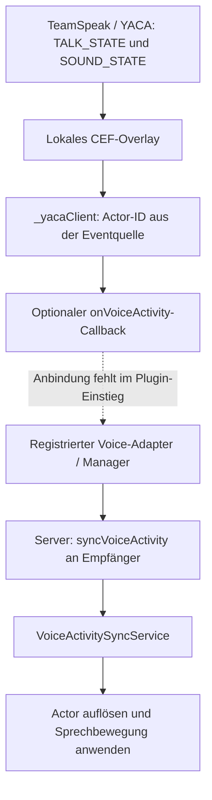

[Deutsch](../../de/docs/docs_voice_lipsync_status.md) · [English](docs_voice_lipsync_status.md) · [Русский](../../ru/docs/docs_voice_lipsync_status.md)

<a id="lipsync-für-voice-chat-stand-und-benötigte-informationen"></a>

# Voice-chat lipsync: status and required information

As of **27 October 2026**. Checked current local sources in `D:\GitHub\skymp` (HEAD `5a70479f1944` plus local changes) and `D:\GitHub\SkyMP-YACA-TS` (HEAD `ab8e9bc55a45` plus local changes). Those commit IDs alone do not include the new local YACA bridge. These findings describe source state, not an installed server/client build or successful game session.

<a id="ist-es-bereits-gelöst"></a>

## Is it already solved?

**Partially prepared, but no complete, game-proven lipsync solution.** The fork contains a voice-activity contract, server distribution and registered client handler. The new YACA bridge detects speaking state but its shipped entry does not connect it to this animation path.

The existing approach sends only **speaking / not speaking**. The client then attempts a dialogue animation. No audio levels, audio data, phonemes or visemes are transmitted or analysed. Audio-driven or phoneme-accurate lip movement is not implemented. Even whether the chosen dialogue animation visibly moves the mouth remains to be proven in Skyrim.

<a id="welche-bausteine-existieren"></a>

## Existing components

| Component | Present in source | Limit |
| --- | --- | --- |
| [Voice contract](../../../../skymp5-server/ts/voiceActivityApi.ts) | `VoiceActivityState`: actor ID, speaking, range in metres, provider, timestamp; `IVoiceProviderAdapter` | The interface creates no voice transport. |
| [Manager](../../../../skymp5-server/ts/voiceActivityManager.ts) | Adapter registration, per-actor state, inactivity timer, broadcast, diagnostics | Registered adapters use lifecycle/timeout; existing Custom Packet input bypasses it. |
| [Server integration](../../../../skymp5-server/ts/index.ts) | `voiceActivity.enabled === true`, recipients, `syncVoiceActivity` | Distance and input need correction; enabling does not connect the new bridge. |
| [Server YACA adapter](../../../../skymp5-server/ts/adapters/YacaTeamSpeakAdapter.ts) | `handleYacaVoiceEvent(...)` creates state and calls callbacks | `initialize()` has no transport; adapter is a skeleton. |
| New local YACA bridge | `SkyMP-YACA-TS/ui/protocol.js`: `TALK_STATE`, `SOUND_STATE`; `src/clientSources.ts`: `_yacaClient`; `src/yacaBridge.ts`: `onVoiceActivity` | Optional callback defaults empty; `tools/build-plugin.cjs` supplies none. |
| [Client service](../../../../skymp5-client/src/services/services/voiceActivitySyncService.ts) | Custom Packets through controller; registered in [index.ts](../../../../skymp5-client/src/index.ts) | Registration proves neither transport nor visible animation. |
| [Animation handler](../../../../skymp5-client/src/sync/voiceActivitySync.ts) | Reads `syncVoiceActivity`, finds actor, calls `playIdle` on `IDLE_DIALOGUE_LOCK` form `0x0005B1B0`, every 2 seconds | Mapping, form effect and reliable stop remain open. |
| [Admin API](../../../../skymp5-server/ts/ui.ts) | `GET /api/admin/voice/status`, `GET /api/admin/voice/speakers`, requiring `canViewLogs` | No frontend diagnostics panel found; healthy adapter does not prove TeamSpeak connection. |

The current bridge requires no `YacaBridgeQuest`, ESP or PEX for voice/UI. Older Papyrus-transport descriptions are proposals and do not describe this new local implementation.

<a id="wie-würde-die-verbindung-aussehen"></a>

## What would the connection look like?



The bridge callback supplies `{ actorId, isSpeaking, voiceRange }`. An adapter would add the provider and server timestamp, then report through its manager-registered callbacks.

An older input also accepts `voiceActivity` and `yaca:voiceActivity` Custom Packets and calls `manager.broadcastVoiceActivity(...)` directly. It therefore does not replace full adapter/manager lifecycle. The new bridge does not use it automatically. Packet shapes and configuration are in the [API reference](docs_voice_api.md).

<a id="was-muss-technisch-noch-erledigt-werden"></a>

## Remaining technical work

These findings follow from current code and initially require no additional operator information:

| Open item | Finding | Required completion |
| --- | --- | --- |
| Connect bridge | `onVoiceActivity` defaults to empty callback. | Deliberately implement a complete speaking-to-animation path. |
| Unify input/lifecycle | Custom Packets bypass registry, range checks and timeout; payload actor ID may replace sender identity. | Derive actor from sender, validate strictly, route start/stop/timeout through one input. |
| Distance units | `getActorPos` gives game coordinates compared directly to metre values in `index.ts`. | Consistent conversion and spatial separation. Bridge already uses `client.unitsPerMeter`, initially 70; calibrate in game. |
| Actor mapping | `voiceActivitySync.ts` passes server ID directly to `Game.getFormEx`; other paths use [remoteIdToLocalId](../../../../skymp5-client/src/view/worldViewMisc.ts). | Resolve dynamic remote actors, handle missing/not streamed actors. |
| Movement and stop | Attempts `playIdle(0x0005B1B0)`; on `false`, stop uses `stopTranslation()` without facial reset. | Prove suitable animation/reset in Skyrim, including movement, combat and competing animations. |
| Timing | Bridge reports changes immediately, unchanged state about every 2 seconds; contract timeout 1000 ms. | Coordinate heartbeat/timeout and correctly inherit manager defaults at startup. Shorter timeout alone cannot fix the gap. |
| Cleanup/lost stops | Client repeats until stop/disconnect, no own expiry; `removePlayer()` only clears server state. | Stop/failsafe on disconnect, despawn, spatial/range changes and reconnect, including prior recipients. |
| Diagnostics counts | `YacaTeamSpeakAdapter` increments speaker counter on every `true`; direct packets bypass registry. | Count per-actor transitions; align diagnostics with actual path. |

Two approaches are possible: repair/connect the existing manager/client path, or implement simple speaking animation entirely in the separate YACA plugin. The latter could apply a neighbour property to the already resolved `ctx.refr`. **This is an implementation proposal, not an existing plugin feature.** Audibility, expiry and animation reset must still be solved.

Changing the built-in client handler requires updated client JavaScript. Whether facial control needs additional native changes depends on the chosen method and game testing. Current findings do not establish a need for another native DLL build.

<a id="welche-informationen-werden-für-die-fertigstellung-benötigt"></a>

## Information needed for completion

The neighbouring project already makes YACA/TeamSpeak the natural starting point. The target environment still needs these decisions and runtime evidence:

| Information | Required content | Purpose |
| --- | --- | --- |
| Mouth movement goal | Simple VAD animation, audio-level animation, or phonemes/visemes | Determines whether boolean state is sufficient. |
| Installed versions | Skyrim EXE, SKSE, SkyrimPlatform/client runtime, server, TeamSpeak, YACA and bridge build | Makes tests reproducible; source does not prove installed files. |
| Speaking behaviour | Proximity/radio? Animate own third-person actor? Mute, room changes, death, competing animations? | Defines display; built-in server normally excludes speaker. |
| Real events | Anonymised `TALK_STATE` start/stop, `SOUND_STATE`, JOIN, disconnect with timestamps/report intervals | Verifies protocol/failsafes; no passwords/tokens needed. |
| Mapping/distance | Server actor ID and local form ID of same remote player, cell/worldspace, known distances | Proves mapping and conversion with real players. |
| Two-player acceptance | Two compatible clients, recorded audible speech and visible mouth movement | Proves complete Skyrim/CEF, TeamSpeak and cleanup path. |

Reliable start/stop is sufficient for simple VAD animation. Audio-level or phoneme control additionally needs an accessible level/viseme stream or defined audio analysis; `TALK_STATE` alone lacks it. Local SkyrimPlatform definitions contain `setExpressionPhoneme`, `setExpressionModifier`, `resetExpressionOverrides`, but this voice path does not use them. Their suitability for the target runtime must be verified.

Target-environment template:

```text
Gewünschte Mundbewegung: VAD / Audiopegel / Phoneme
Skyrim / SKSE / SkyrimPlatform-Client:
Serverbuild / Clientpaket / Bridge-Build:
TeamSpeak-Version / YACA-Plugin-Version:
Nähe / Funk / eigener Actor in dritter Person:
Mute-, Tod-, Raumwechsel- und Animationsregeln:
Anonymisierte Start-/Stop-/Disconnect-Ereignisse mit Zeitstempeln:
Remote-Actor-ID / lokale Form-ID / Testabstände:
Zwei Testclients verfügbar:
```

<a id="wie-wird-der-abschluss-geprüft"></a>

## How is completion checked?

1. Join the same room with two clients. A speaks/stops; B must see the correct actor animate and return to normal. Reverse roles and test simultaneous speech.
2. Speak longer than timeout/heartbeat, then pause briefly. Continuous speech must not suffer timeout gaps.
3. Mute microphone, disconnect/reconnect YACA/TeamSpeak. Animation must stop reliably and work after reconnect.
4. Cross known range boundaries, change interiors, stream actors out/in. No stuck speaking or wrong actor ID.
5. Test walking, sprinting, combat and competing dialogue/facial animations; then radio and own third-person view as agreed.
6. Record versions, events, packets, actor mapping and visible result together. Only this run proves working voice lipsync.

<a id="nachweis-dieses-dokumentationsabgleichs"></a>

## Evidence for this documentation comparison

- Read and compared server, client, plugin entry and bridge sources; linked files underpin the findings.
- `npm run test:voice-sync` passed in `skymp5-client` on 27 October 2026, exit 0: recognises `syncVoiceActivity`, ignores unrelated types, handles invalid JSON. Parser evidence only.
- No Skyrim/CEF game test, real TeamSpeak audio or multiplayer animation acceptance in this run. Older bridge/mock tests were not rerun for this documentation task.

Further reading: [Voice API and current packets](docs_voice_api.md), [plugin system](../README-plugins.md#voice-activity-adapters-für-lipsync--proximity-chat), [voice backlog](../ROADMAP.md#voice--proximity-chat-sync-backlog-proposed).
