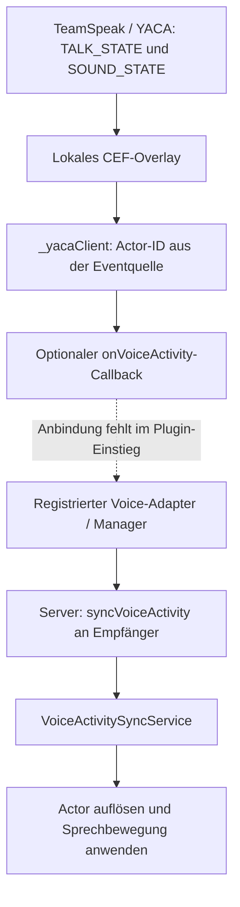

[Deutsch](../../de/docs/docs_voice_lipsync_status.md) · [English](../../en/docs/docs_voice_lipsync_status.md) · [Русский](docs_voice_lipsync_status.md)

<a id="lipsync-für-voice-chat-stand-und-benötigte-informationen"></a>

# Lipsync голосового чата: состояние и необходимые данные

Состояние на **27 октября 2026 года**. Проверены локальные исходники `D:\GitHub\skymp` (HEAD `5a70479f1944` плюс изменения) и `D:\GitHub\SkyMP-YACA-TS` (HEAD `ab8e9bc55a45` плюс изменения). Сами коммиты не включают новый локальный мост YACA. Описаны исходники, а не установленные сборки или успешная игра.

<a id="ist-es-bereits-gelöst"></a>

## Уже решено?

**Частично подготовлено, но полной подтверждённой в игре lipsync нет.** Есть контракт активности, серверная рассылка и клиентский обработчик. Новый мост YACA определяет речь, но поставляемый entry не соединяет её с анимацией.

Подход передаёт только **говорит / не говорит**. Затем клиент пытается запустить диалоговую анимацию. Громкость, аудио, фонемы, виземы не передаются и не анализируются. Синхронизация по аудио/фонемам не реализована. Даже видимое движение рта выбранной анимации ещё нужно подтвердить в Skyrim.

<a id="welche-bausteine-existieren"></a>

## Существующие части

| Компонент | Есть в исходниках | Ограничение |
| --- | --- | --- |
| [Контракт](../../../../skymp5-server/ts/voiceActivityApi.ts) | `VoiceActivityState`: ID, речь, дальность в метрах, провайдер, время; `IVoiceProviderAdapter` | Интерфейс не создаёт транспорт. |
| [Manager](../../../../skymp5-server/ts/voiceActivityManager.ts) | Адаптеры, состояния актёров, таймер, рассылка, диагностика | Адаптеры используют lifecycle/timeout; прямой Custom Packet обходит его. |
| [Сервер](../../../../skymp5-server/ts/index.ts) | `voiceActivity.enabled === true`, получатели, `syncVoiceActivity` | Исправить расстояния/вход; включение не соединяет мост. |
| [Адаптер YACA](../../../../skymp5-server/ts/adapters/YacaTeamSpeakAdapter.ts) | `handleYacaVoiceEvent(...)` создаёт состояние и callbacks | В `initialize()` нет транспорта; это каркас. |
| Новый мост YACA | `SkyMP-YACA-TS/ui/protocol.js`: `TALK_STATE`, `SOUND_STATE`; `src/clientSources.ts`: `_yacaClient`; `src/yacaBridge.ts`: `onVoiceActivity` | Callback по умолчанию пуст; `tools/build-plugin.cjs` его не передаёт. |
| [Клиентский сервис](../../../../skymp5-client/src/services/services/voiceActivitySyncService.ts) | Custom Packet через controller; зарегистрирован в [index.ts](../../../../skymp5-client/src/index.ts) | Регистрация не доказывает транспорт/анимацию. |
| [Анимация](../../../../skymp5-client/src/sync/voiceActivitySync.ts) | Читает `syncVoiceActivity`, ищет актёра, `playIdle` формы `IDLE_DIALOGUE_LOCK` `0x0005B1B0` каждые 2 секунды | Сопоставление, действие формы, надёжный stop открыты. |
| [Admin API](../../../../skymp5-server/ts/ui.ts) | `GET /api/admin/voice/status`, `GET /api/admin/voice/speakers`, `canViewLogs` | Панель frontend не найдена; здоровье адаптера не доказывает TeamSpeak. |

Мост не требует `YacaBridgeQuest`, ESP или PEX для voice/UI. Старые описания Papyrus — проекты, не новая локальная реализация.

<a id="wie-würde-die-verbindung-aussehen"></a>

## Как соединить?



Callback моста возвращает `{ actorId, isSpeaking, voiceRange }`. Адаптер должен добавить провайдер/серверное время и передать через callbacks, зарегистрированные у manager.

Есть старый вход Custom Packet `voiceActivity`/`yaca:voiceActivity`, напрямую вызывающий `manager.broadcastVoiceActivity(...)`. Он не заменяет полный lifecycle адаптера/manager. Новый мост не использует его автоматически. Пакеты/настройки — в [API](docs_voice_api.md).

<a id="was-muss-technisch-noch-erledigt-werden"></a>

## Оставшиеся технические работы

Пункты следуют из кода и сначала не требуют дополнительных данных оператора:

| Задача | Наблюдение | Что завершить |
| --- | --- | --- |
| Соединить мост | `onVoiceActivity` по умолчанию пуст. | Выбрать и реализовать полный путь от речи к анимации. |
| Общий вход/lifecycle | Прямые пакеты обходят реестр, дальность, таймер; payload ID может заменить отправителя. | Определять актёра сервером, строго проверять поля, проводить start/stop/timeout через один вход. |
| Единицы расстояния | Координаты `getActorPos` прямо сравниваются с метрами в `index.ts`. | Общий пересчёт и разделение пространств. Мост использует `client.unitsPerMeter`, начально 70; откалибровать в игре. |
| Сопоставление актёра | `voiceActivitySync.ts` передаёт серверный ID в `Game.getFormEx`; другие пути используют [remoteIdToLocalId](../../../../skymp5-client/src/view/worldViewMisc.ts). | Разрешать динамические ID, учитывать отсутствующих/не загруженных актёров. |
| Видимое движение/stop | `playIdle(0x0005B1B0)`, при `false` остановка `stopTranslation()` без сброса лица. | Доказать подходящую анимацию/сброс при ходьбе, бое, конкурирующих анимациях. |
| Интервалы | Мост сообщает изменения сразу, без изменений примерно 2 секунды; timeout 1000 мс. | Согласовать heartbeat/timeout, правильно наследовать defaults; более короткий timeout не решает разрыв. |
| Очистка/потерянный stop | Клиент повторяет до stop/разрыва, своего срока нет; `removePlayer()` очищает только сервер. | Failsafe при разрыве, despawn, смене пространства/дальности, reconnect, включая прежних получателей. |
| Счётчики | `YacaTeamSpeakAdapter` увеличивает число при каждом `true`; прямые пакеты не попадают в реестр. | Считать переходы по актёрам и согласовать диагностику с путём. |

Возможны два пути: исправить/соединить существующий manager/клиент либо реализовать простую речевую анимацию целиком в YACA. Во втором случае свойство соседа может применить состояние к уже разрешённому `ctx.refr`. **Это предложение, а не существующая функция.** Слышимость, истечение и сброс всё равно нужно решить.

Изменение встроенного обработчика требует обновлённый клиентский JavaScript. Нужны ли нативные изменения лица, зависит от метода и игры. По текущим данным необходимость новой DLL не доказана.

<a id="welche-informationen-werden-für-die-fertigstellung-benötigt"></a>

## Какие данные нужны?

Соседний проект делает YACA/TeamSpeak естественной отправной точкой. Ещё нужны решения и свидетельства целевой среды:

| Данные | Содержание | Цель |
| --- | --- | --- |
| Цель движения рта | Простое VAD, громкость, фонемы/виземы | Определяет достаточность bool. |
| Установленные версии | Skyrim EXE, SKSE, SkyrimPlatform/runtime, сервер, TeamSpeak, YACA, мост | Воспроизводимость; исходники не доказывают установку. |
| Поведение речи | Близость/радио, собственный вид от третьего лица, mute, комнаты, смерть, другие анимации | Ожидания UI; сервер обычно исключает говорящего. |
| Реальные события | Обезличенные `TALK_STATE` start/stop, `SOUND_STATE`, JOIN, разрыв, время/интервал | Протокол/failsafe; пароли/токены не нужны. |
| ID/расстояния | Серверный ID и локальный form ID одного игрока, cell/worldspace, известные расстояния | Проверка mapping и метров на реальных игроках. |
| Два игрока | Совместимые клиенты, запись слышимой речи и движения рта | Полный путь Skyrim/CEF, TeamSpeak, очистка. |

Для простого VAD достаточно надёжных start/stop. Для громкости/фонем нужен доступный поток уровней/визем или аудиоанализ; `TALK_STATE` этого не даёт. Локальные определения SkyrimPlatform имеют `setExpressionPhoneme`, `setExpressionModifier`, `resetExpressionOverrides`, но текущий voice-путь их не использует. Совместимость с runtime нужно проверить.

Шаблон целевой среды:

```text
Gewünschte Mundbewegung: VAD / Audiopegel / Phoneme
Skyrim / SKSE / SkyrimPlatform-Client:
Serverbuild / Clientpaket / Bridge-Build:
TeamSpeak-Version / YACA-Plugin-Version:
Nähe / Funk / eigener Actor in dritter Person:
Mute-, Tod-, Raumwechsel- und Animationsregeln:
Anonymisierte Start-/Stop-/Disconnect-Ereignisse mit Zeitstempeln:
Remote-Actor-ID / lokale Form-ID / Testabstände:
Zwei Testclients verfügbar:
```

<a id="wie-wird-der-abschluss-geprüft"></a>

## Как проверить завершение?

1. Двумя клиентами войти в одну комнату. A говорит/молчит, B видит правильного актёра и возврат к норме. Поменяться и говорить одновременно.
2. Говорить дольше timeout/heartbeat, затем короткие паузы. Непрерывная речь не прерывает движение по таймауту.
3. Mute, разрыв/возврат YACA/TeamSpeak: надёжная остановка и работа после reconnect.
4. Пересечь известные границы дальности, сменить помещение, выгрузить/загрузить актёров. Нет зависшей речи/чужого ID.
5. Ходьба, спринт, бой, диалоговые/лицевые анимации; радио и свой третий вид по согласованным правилам.
6. Вместе записать версии, события, пакеты, mapping и результат. Только этот прогон доказывает voice lipsync.

<a id="nachweis-dieses-dokumentationsabgleichs"></a>

## Свидетельства сверки документации

- Прочитаны и сопоставлены сервер, клиент, entry и мост; ссылки подтверждают выводы.
- `npm run test:voice-sync` в `skymp5-client` пройден 27.10.2026, код 0: `syncVoiceActivity`, чужие типы, неверный JSON. Только парсер.
- В этом прогоне нет Skyrim/CEF, настоящего TeamSpeak-аудио и многопользовательской приёмки анимации. Старые bridge/mock-тесты заново не запускались.

Подробнее: [Voice API и пакеты](docs_voice_api.md), [система плагинов](../README-plugins.md#voice-activity-adapters-für-lipsync--proximity-chat), [задачи Voice](../ROADMAP.md#voice--proximity-chat-sync-backlog-proposed).
